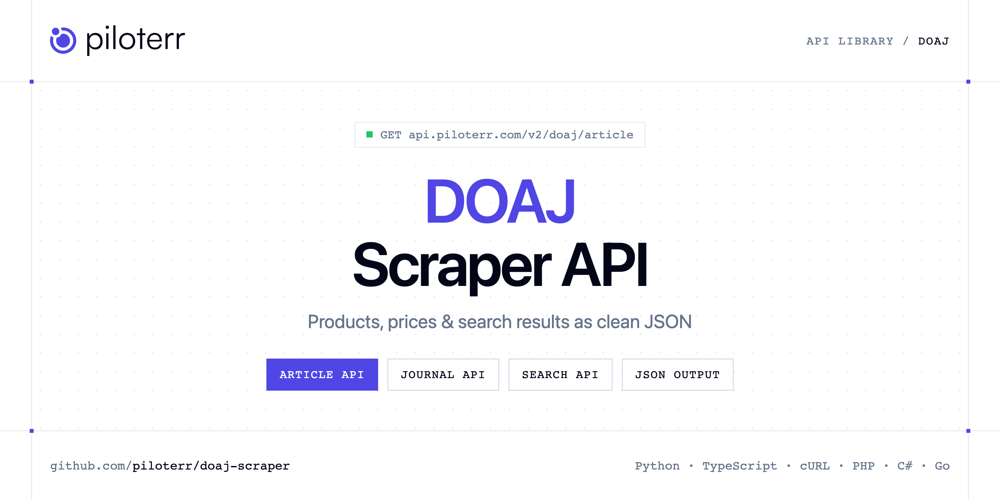

<p align="center">
  <a href="https://www.piloterr.com"></a>
</p>

# DOAJ Scraper API

[](https://discord.gg/CFj3ph8aHU) [](https://app.piloterr.com) [](https://app.piloterr.com/openapi) [](LICENSE)

The **Piloterr DOAJ Scraper API** lets you extract public data from DOAJ as **clean, structured JSON** — no proxies, headless browsers or HTML parsing to maintain. Endpoints available in production:

- **DOAJ Article API** — Fetch one DOAJ article by its id or by a doaj.org article URL.
- **DOAJ Journal API** — Fetch one DOAJ journal by ISSN, journal id, or a doaj.org toc URL.
- **DOAJ Search API** — Search DOAJ articles or journals.

Use it for price monitoring, assortment tracking, competitor analysis, product research or catalog enrichment.

| Endpoint | Path | Credits | What you get |
|---|---|---|---|
| [DOAJ Article API](#doaj-article-api) | `/v2/doaj/article` | 1 | Fetch one DOAJ article by its id or by a doaj.org article URL. |
| [DOAJ Journal API](#doaj-journal-api) | `/v2/doaj/journal` | 1 | Fetch one DOAJ journal by ISSN, journal id, or a doaj.org toc URL. |
| [DOAJ Search API](#doaj-search-api) | `/v2/doaj/search` | 1 | Search DOAJ articles or journals. kind is article (default) or journal. Article ids and journal ISSNs are the detail keys. |

## Table of contents

- [How it works](#how-it-works)
- [DOAJ Article API](#doaj-article-api)
- [DOAJ Journal API](#doaj-journal-api)
- [DOAJ Search API](#doaj-search-api)
- [Code examples in other languages](#code-examples-in-other-languages)
- [Practical use cases](#practical-use-cases)
- [Why Piloterr?](#why-piloterr)
- [FAQ](#faq)
- [Related scrapers](#related-scrapers)
- [Support](#support)

## How it works

1. **Create a free Piloterr account** and copy your API key from the [dashboard](https://app.piloterr.com).
2. **Send a `GET` (or `POST`) request** to `https://api.piloterr.com/v2/...` with the header `x-api-key: YOUR_API_KEY`.
3. **Receive structured JSON** — Piloterr handles rendering, proxies, retries and parsing.

```bash
export PILOTERR_API_KEY="your-api-key"
pip install requests        # Python
# TypeScript: Node.js 18+ (native fetch), run with `npx tsx file.ts`
```

> Every endpoint accepts both `GET` (query string) and `POST` (JSON body with the same fields).

## DOAJ Article API

Fetch one DOAJ article by its id or by a doaj.org article URL.

`GET | POST https://api.piloterr.com/v2/doaj/article` · **1 credit per request** · [Full reference](https://app.piloterr.com/openapi)

### Request parameters

| Parameter | Type | Required | Description |
|---|---|---|---|
| `query` | string | ✅ | Required. Article id or a doaj.org/article URL. Example: 000004687a3a411cb466625281f2ceb0. |

### Python example

```python
import json
import os
import requests

response = requests.get(
    "https://api.piloterr.com/v2/doaj/article",
    headers={"x-api-key": os.environ["PILOTERR_API_KEY"]},
    params={
        "query": "000004687a3a411cb466625281f2ceb0.",
    },
    timeout=120,
)
response.raise_for_status()
data = response.json()

print(json.dumps(data, indent=2, ensure_ascii=False)[:2000])
```

### TypeScript example

```typescript
type DoajArticle = {
  id?: string;
  doi?: string;
  url?: string;
  year?: string;
  issue?: string;
  month?: string;
  title?: string;
  volume?: string;
  authors?: {
    name?: string;
    affiliation?: string;
  }[];
  abstract?: string;
  end_page?: unknown;
  keywords?: string[];
  subjects?: string[];
  start_page?: unknown;
  fulltext_url?: string;
  journal_issn?: unknown;
  journal_title?: string;
};

const params = new URLSearchParams({
  "query": "000004687a3a411cb466625281f2ceb0.",
});

const response = await fetch(`https://api.piloterr.com/v2/doaj/article?${params}`, {
  headers: { "x-api-key": process.env.PILOTERR_API_KEY! },
});
if (!response.ok) throw new Error(`Piloterr error ${response.status}: ${await response.text()}`);

const data = (await response.json()) as DoajArticle;

console.log(JSON.stringify(data, null, 2).slice(0, 2000));
```

<details>
<summary><b>POST variant</b></summary>

```http
POST https://api.piloterr.com/v2/doaj/article
x-api-key: YOUR_API_KEY
Content-Type: application/json

{"query": "000004687a3a411cb466625281f2ceb0."}
```
</details>

### Output example

Example response from the API reference, abridged — real values depend on the page you scrape.

```json
{
  "id": "000004687a3a411cb466625281f2ceb0",
  "doi": "10.1002/ece3.8411",
  "url": "https://doaj.org/article/000004687a3a411cb466625281f2ceb0",
  "year": "2021",
  "issue": "24",
  "month": "12",
  "title": "Fishing, predation, and temperature drive herring decline in a large marine ecosystem",
  "volume": "11",
  "authors": [
    {
      "name": "example",
      "affiliation": "example"
    },
    {
      "name": "example",
      "affiliation": "example"
    }
  ],
  "abstract": "Abstract Since 1960, landings of Atlantic herring have been the greatest of any marine species in Canada, surpassing Atlantic cod and acc…",
  "end_page": null,
  "keywords": [
    "Atlantic herring",
    "climate change"
  ],
  "subjects": [
    "Ecology"
  ],
  "start_page": null,
  "fulltext_url": "https://doi.org/10.1002/ece3.8411",
  "journal_issn": null,
  "journal_title": "Ecology and Evolution"
}
```

### Response fields

| Field | Type | Description |
|---|---|---|
| `id` | string |  |
| `doi` | string |  |
| `url` | string |  |
| `year` | string |  |
| `issue` | string |  |
| `month` | string |  |
| `title` | string |  |
| `volume` | string |  |
| `authors[]` | object[] |  |
| `authors[].name` | string |  |
| `authors[].affiliation` | string |  |
| `abstract` | string |  |
| `end_page` | object |  |
| `keywords` | string[] |  |
| `subjects` | string[] |  |
| `start_page` | object |  |
| `fulltext_url` | string |  |
| `journal_issn` | object |  |
| `journal_title` | string |  |

## DOAJ Journal API

Fetch one DOAJ journal by ISSN, journal id, or a doaj.org toc URL.

`GET | POST https://api.piloterr.com/v2/doaj/journal` · **1 credit per request** · [Full reference](https://app.piloterr.com/openapi)

### Request parameters

| Parameter | Type | Required | Description |
|---|---|---|---|
| `query` | string | ✅ | Required. Journal ISSN, journal id, or a doaj.org/toc URL. Example: 2747-173X. |

### Python example

```python
import json
import os
import requests

response = requests.get(
    "https://api.piloterr.com/v2/doaj/journal",
    headers={"x-api-key": os.environ["PILOTERR_API_KEY"]},
    params={
        "query": "2747-173X.",
    },
    timeout=120,
)
response.raise_for_status()
data = response.json()

print(json.dumps(data, indent=2, ensure_ascii=False)[:2000])
```

### TypeScript example

```typescript
type DoajJournal = {
  id?: string;
  url?: string;
  eissn?: string;
  pissn?: unknown;
  title?: string;
  has_apc?: boolean;
  license?: string;
  keywords?: string[];
  oa_start?: string;
  subjects?: string[];
  languages?: string[];
  publisher?: string;
  license_url?: string;
  alternative_title?: string;
  publisher_country?: string;
};

const params = new URLSearchParams({
  "query": "2747-173X.",
});

const response = await fetch(`https://api.piloterr.com/v2/doaj/journal?${params}`, {
  headers: { "x-api-key": process.env.PILOTERR_API_KEY! },
});
if (!response.ok) throw new Error(`Piloterr error ${response.status}: ${await response.text()}`);

const data = (await response.json()) as DoajJournal;

console.log(JSON.stringify(data, null, 2).slice(0, 2000));
```

<details>
<summary><b>POST variant</b></summary>

```http
POST https://api.piloterr.com/v2/doaj/journal
x-api-key: YOUR_API_KEY
Content-Type: application/json

{"query": "2747-173X."}
```
</details>

### Output example

Example response from the API reference, abridged — real values depend on the page you scrape.

```json
{
  "id": "00087d1be705481c92efc11a6dc42b80",
  "url": "https://doaj.org/toc/2747-173X",
  "eissn": "2747-173X",
  "pissn": null,
  "title": "Computational and Experimental Research in Materials and Renewable Energy",
  "has_apc": false,
  "license": "CC BY-SA",
  "keywords": [
    "renewable energy",
    "nuclear materials"
  ],
  "oa_start": "2018",
  "subjects": [
    "Renewable energy sources"
  ],
  "languages": [
    "EN"
  ],
  "publisher": "Physics Department, Faculty of Mathematics and Natural Sciences University of Jember",
  "license_url": "https://creativecommons.org/licenses/by-sa/4.0/",
  "alternative_title": "CERiMRE",
  "publisher_country": "ID"
}
```

### Response fields

| Field | Type | Description |
|---|---|---|
| `id` | string |  |
| `url` | string |  |
| `eissn` | string |  |
| `pissn` | object |  |
| `title` | string |  |
| `has_apc` | boolean |  |
| `license` | string |  |
| `keywords` | string[] |  |
| `oa_start` | string |  |
| `subjects` | string[] |  |
| `languages` | string[] |  |
| `publisher` | string |  |
| `license_url` | string |  |
| `alternative_title` | string |  |
| `publisher_country` | string |  |

## DOAJ Search API

Search DOAJ articles or journals. kind is article (default) or journal. Article ids and journal ISSNs are the detail keys.

`GET | POST https://api.piloterr.com/v2/doaj/search` · **1 credit per request** · [Full reference](https://app.piloterr.com/openapi)

### Request parameters

| Parameter | Type | Required | Description |
|---|---|---|---|
| `query` | string | ✅ | Required. Keyword or a doaj.org search URL. Example: climate. An article or journal URL returns 400. |
| `kind` | string | — | Optional. article or journal. Example: journal. Defaults to article. |
| `page` | number | — | Optional. Page number from 1. Example: 2. Defaults to 1. Each page has 10 records. |

### Python example

```python
import json
import os
import requests

response = requests.get(
    "https://api.piloterr.com/v2/doaj/search",
    headers={"x-api-key": os.environ["PILOTERR_API_KEY"]},
    params={
        "query": "climate. An article or journal URL returns 400.",
    },
    timeout=120,
)
response.raise_for_status()
data = response.json()

print(json.dumps(data, indent=2, ensure_ascii=False)[:2000])
```

### TypeScript example

```typescript
type DoajSearch = {
  results?: {
    id?: string;
    doi?: string;
    url?: string;
    year?: string;
    issue?: string;
    month?: string;
    title?: string;
    volume?: string;
    authors?: {
      name?: string;
      affiliation?: string;
    }[];
    abstract?: string;
    end_page?: string;
    keywords?: string[];
    subjects?: string[];
    start_page?: string;
    fulltext_url?: string;
    journal_issn?: string;
    journal_title?: string;
  }[];
  pagination?: {
    next?: string;
    page?: number;
    per_page?: number;
    total_pages?: number;
    total_results?: number;
  };
};

const params = new URLSearchParams({
  "query": "climate. An article or journal URL returns 400.",
});

const response = await fetch(`https://api.piloterr.com/v2/doaj/search?${params}`, {
  headers: { "x-api-key": process.env.PILOTERR_API_KEY! },
});
if (!response.ok) throw new Error(`Piloterr error ${response.status}: ${await response.text()}`);

const data = (await response.json()) as DoajSearch;

console.log(JSON.stringify(data, null, 2).slice(0, 2000));
```

<details>
<summary><b>POST variant</b></summary>

```http
POST https://api.piloterr.com/v2/doaj/search
x-api-key: YOUR_API_KEY
Content-Type: application/json

{"query": "climate. An article or journal URL returns 400."}
```
</details>

### Output example

Example response from the API reference, abridged — real values depend on the page you scrape.

```json
{
  "results": [
    {
      "id": "000004687a3a411cb466625281f2ceb0",
      "doi": "10.1002/ece3.8411",
      "url": "https://doaj.org/article/000004687a3a411cb466625281f2ceb0",
      "year": "2021",
      "issue": "24",
      "month": "12",
      "title": "Fishing, predation, and temperature drive herring decline in a large marine ecosystem",
      "volume": "11",
      "authors": [
        {},
        {}
      ],
      "abstract": "Abstract Since 1960, landings of Atlantic herring have been the greatest of any marine species in Canada, surpassing Atlantic cod and acc…",
      "end_page": "18150",
      "keywords": [
        "Atlantic herring",
        "climate change"
      ],
      "subjects": [
        "Ecology"
      ],
      "start_page": "18136",
      "fulltext_url": "https://doi.org/10.1002/ece3.8411",
      "journal_issn": "2045-7758",
      "journal_title": "Ecology and Evolution"
    }
  ],
  "pagination": {
    "next": "https://doaj.org/search/articles/climate?page=2",
    "page": 1,
    "per_page": 10,
    "total_pages": 27197,
    "total_results": 271961
  }
}
```

### Response fields

| Field | Type | Description |
|---|---|---|
| `results[]` | object[] |  |
| `results[].id` | string |  |
| `results[].doi` | string |  |
| `results[].url` | string |  |
| `results[].year` | string |  |
| `results[].issue` | string |  |
| `results[].month` | string |  |
| `results[].title` | string |  |
| `results[].volume` | string |  |
| `results[].authors[]` | object[] |  |
| `results[].abstract` | string |  |
| `results[].end_page` | string |  |
| `results[].keywords` | string[] |  |
| `results[].subjects` | string[] |  |
| `results[].start_page` | string |  |
| `results[].fulltext_url` | string |  |
| `results[].journal_issn` | string |  |
| `results[].journal_title` | string |  |
| `pagination` | object |  |
| `pagination.next` | string |  |
| `pagination.page` | integer |  |
| `pagination.per_page` | integer |  |
| `pagination.total_pages` | integer |  |
| `pagination.total_results` | integer |  |

## Code examples in other languages

Ready-to-run examples live in the [`examples/`](examples) folder. Each one reads your key from the `PILOTERR_API_KEY` environment variable.

| Language | Article | Journal | Search |
|---|---|---|---|
| cURL (Bash) | [`article`](examples/curl/article.sh) | [`journal`](examples/curl/journal.sh) | [`search`](examples/curl/search.sh) |
| PHP | [`article`](examples/php/article.php) | [`journal`](examples/php/journal.php) | [`search`](examples/php/search.php) |
| C# | [`article`](examples/csharp/Article.cs) | [`journal`](examples/csharp/Journal.cs) | [`search`](examples/csharp/Search.cs) |
| Go | [`article`](examples/go/article.go) | [`journal`](examples/go/journal.go) | [`search`](examples/go/search.go) |
| Java | [`article`](examples/java/ArticleExample.java) | [`journal`](examples/java/JournalExample.java) | [`search`](examples/java/SearchExample.java) |
| Ruby | [`article`](examples/ruby/article.rb) | [`journal`](examples/ruby/journal.rb) | [`search`](examples/ruby/search.rb) |
| Node.js | [`article`](examples/nodejs/article.mjs) | [`journal`](examples/nodejs/journal.mjs) | [`search`](examples/nodejs/search.mjs) |

## Practical use cases

- **Price monitoring** — Track prices, promotions and availability over time to react to competitors.
- **Assortment & catalog tracking** — Follow new products, delisted items and category changes.
- **Competitor analysis** — Benchmark ranges, brands and positioning across retailers.
- **Product research** — Spot best-sellers and trends from search results.
- **Catalog enrichment** — Pull titles, images and attributes into your PIM or marketplace listings.

## Why Piloterr?

- **No infrastructure** — no proxies, headless browsers or CAPTCHA solving to run yourself.
- **Structured JSON** — stable, documented fields instead of brittle HTML selectors.
- **Pay per request** — transparent credit cost per endpoint, failed requests are retried for you.
- **One API key, hundreds of sources** — DOAJ plus many other e-commerce, search and company data endpoints in the [Piloterr library](https://www.piloterr.com/library).
- **Any language** — plain HTTPS + JSON, with examples for Python, TypeScript, cURL, PHP, C#, Go, Java, Ruby and Node.js.

## FAQ

### Is it legal to scrape DOAJ?

Collecting publicly available data is generally allowed in many jurisdictions, but rules depend on your country, the data you collect and how you use it. Avoid personal data unless you have a lawful basis, respect the website's terms where they apply, and get legal advice for your specific use case. This is not legal advice.

### Do I need proxies or a headless browser?

No. Piloterr handles rendering, proxy rotation and retries on its side. You only send an HTTPS request with your `x-api-key` header and receive JSON.

### How much does a request cost?

Credits per call: `/v2/doaj/article` **1**, `/v2/doaj/journal` **1**, `/v2/doaj/search` **1**. See the [Piloterr website](https://www.piloterr.com) for plans.

### What data does the DOAJ API return?

Each endpoint returns structured JSON: **DOAJ Article** — `id`, `doi`, `url`, `year`, `issue`, `month`; **DOAJ Journal** — `id`, `url`, `eissn`, `pissn`, `title`, `has_apc`; **DOAJ Search** — `results[]`, `results[].id`, `results[].doi`, `results[].url`, `results[].year`, `results[].issue`.

### How do I paginate DOAJ results?

Use the `page` parameter and keep requesting while the response indicates more results.

### Which languages are supported?

Any language that can make an HTTP request. This README shows Python and TypeScript; the [`examples/`](examples) folder contains cURL, PHP, C#, Go, Java, Ruby and Node.js.

## Related scrapers

- [About You Scraper API](https://github.com/piloterr/aboutyou-scraper)
- [Action Scraper API](https://github.com/piloterr/action-scraper)
- [Aldi Scraper API](https://github.com/piloterr/aldi-scraper)
- [Alibaba Scraper API](https://github.com/piloterr/alibaba-scraper)
- [AliExpress Scraper API](https://github.com/piloterr/aliexpress-scraper)
- [Allegro Scraper API](https://github.com/piloterr/allegro-scraper)
- [All Piloterr scrapers on GitHub](https://github.com/piloterr)

## Support

- 💬 Join the [Piloterr Discord](https://discord.gg/CFj3ph8aHU) to ask questions and share what you build.
- 📚 Browse the [API reference (OpenAPI)](https://app.piloterr.com/openapi) and the [Piloterr library](https://www.piloterr.com/library).
- 🔑 [Get your API key](https://app.piloterr.com).

---

<p align="center">
  <a href="https://www.piloterr.com">
    <picture>
      <source media="(prefers-color-scheme: dark)" srcset="images/logo-dark.svg">
      
    </picture>
  </a>
  <br>
  <sub>Built by <a href="https://www.piloterr.com">Piloterr</a> — web scraping APIs for e-commerce, search, real estate and more, one API key.</sub>
</p>

<sub>DOAJ is a trademark of its respective owner. This repository is not affiliated with or endorsed by DOAJ. Examples are released under the MIT license.</sub>
